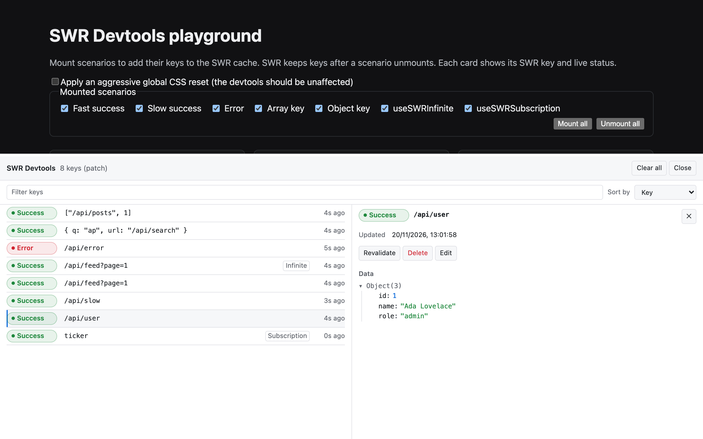

# swr-devtools-react

[](https://www.npmjs.com/package/swr-devtools-react)
[](https://github.com/TheFlyer1983/swr-devtools-react/actions/workflows/ci.yml)

In-app devtools for [SWR](https://swr.vercel.app): see every cache key, then revalidate, edit or delete it from a floating panel. Inspired by TanStack Query Devtools.

**[Documentation and live demo](https://swr-devtools-react.theflyer1983.dev)**



## Features

- Every key in the SWR cache, with a status badge (loading, validating, success, error, idle) and the time since it was last updated. The list updates live.
- Array and object keys shown readably. `useSWRInfinite` and `useSWRSubscription` keys are labelled.
- Search keys by text, and sort by key, status or last updated.
- A detail view with the full key, any error, and the data as a collapsible JSON tree.
- Revalidate, edit or delete a key, or clear the whole cache.
- Renders inside a Shadow DOM, so your app's CSS can't break it and its CSS can't leak into your app.
- Renders nothing in production builds, and its code is left out of the browser bundle.

## Install

```bash
npm install --save-dev swr-devtools-react
```

```bash
pnpm add --save-dev swr-devtools-react
```

It needs React 18 or 19 and SWR 2 in your app. It's a dev dependency because production builds drop it.

Install it as a regular dependency instead if you [force it on for staging](https://swr-devtools-react.theflyer1983.dev/production/#forcing-it-on-eg-staging), or if a Next.js app using the Pages Router runs its server with only production dependencies installed (for example `npm ci --omit=dev` in a Docker image). Otherwise those pages fail with a 500. [Production and staging](https://swr-devtools-react.theflyer1983.dev/production/#dev-dependency-or-regular-dependency) explains why, and how to keep it a dev dependency with `transpilePackages`.

## Setup

Add `<SWRDevtools />` inside your `<SWRConfig>`. There's no provider or middleware to add.

```tsx
import { SWRConfig } from 'swr';
import { SWRDevtools } from 'swr-devtools-react';

export function Root() {
  return (
    <SWRConfig value={{ fetcher }}>
      <App />
      <SWRDevtools />
    </SWRConfig>
  );
}
```

A button labelled "SWR" appears in the corner. Click it to open the panel.

## Documentation

- [Getting started](https://swr-devtools-react.theflyer1983.dev/getting-started/)
- [Next.js](https://swr-devtools-react.theflyer1983.dev/nextjs/), with the App Router and the Pages Router
- [Using the panel](https://swr-devtools-react.theflyer1983.dev/panel/inspecting-data/): inspecting, searching, editing, revalidating and deleting keys
- [Production and staging](https://swr-devtools-react.theflyer1983.dev/production/)
- [API reference](https://swr-devtools-react.theflyer1983.dev/api-reference/): props for `<SWRDevtools />` and `<SWRDevtoolsPanel />`
- [Known limits](https://swr-devtools-react.theflyer1983.dev/known-limits/)

## Roadmap

Next up are a TanStack Devtools plugin, observer counts per key, and a light theme that follows the system setting. The [spec](https://github.com/TheFlyer1983/swr-devtools-react/blob/main/docs/SPEC.md) lists what's planned, and the [project board](https://github.com/users/TheFlyer1983/projects/7) shows what's in progress.

## Contributing

See [CONTRIBUTING.md](https://github.com/TheFlyer1983/swr-devtools-react/blob/main/CONTRIBUTING.md) for local setup, the playgrounds and how PRs work.

## Licence

[MIT](https://github.com/TheFlyer1983/swr-devtools-react/blob/main/LICENSE)
